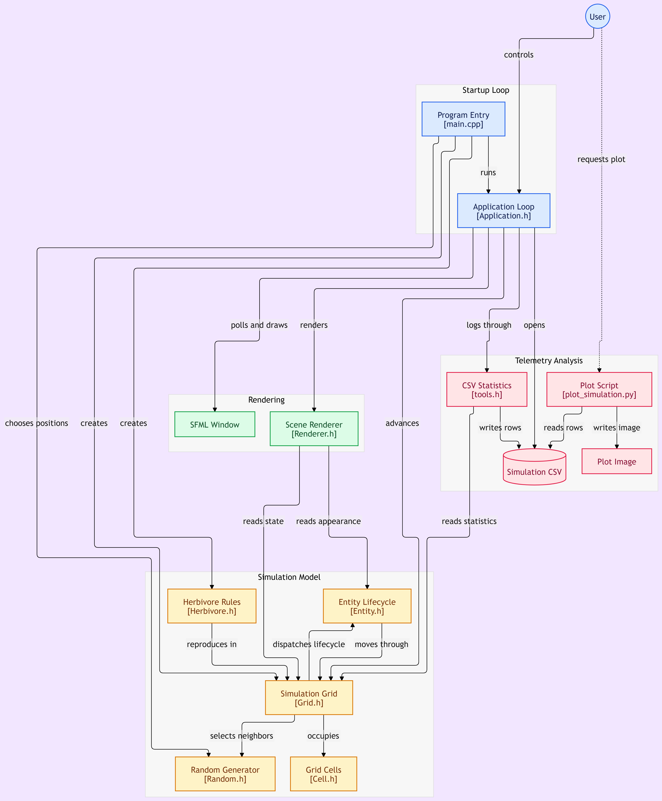

## Lien vers le compte rendu par séance
https://docs.google.com/document/d/1V6TwwtPyWplslxlLsV6yeguGusbax4Ohi6p5mdXQ9ao/edit?usp=sharing

## User input :
```text
    - space : set simulation on pause / resume
    - tab : switch between simulation and graph
    - esc : quit the simulation
```

## Statistiques en direct

Le panneau de la vue simulation affiche les effectifs et les taux observés de
reproduction (naissances) et de mortalité de chaque espèce. Les taux sont exprimés
en pourcentage par pas, sur les 50 derniers pas de simulation :
`100 * nombre d'événements / somme des populations au début de chaque pas`.
La population initiale est exclue des naissances mesurées. La pause fige les mesures.

## Générer un graphique avec python :
*Pré-requis: pip et matplotlib (installé avec pip)*  
  
```shell
python plot_simulation.py simulation_data.csv data_plot.png
```
  
## Template `run.sh` pour build et lancer le projet:
```shell
cmake -B build
cmake --build build

# Path to RTS executable (change if needed)
build/bin/main # add --csv to generate CSV instead of display
```


# Architecture du projet


## Optimisations et vérification

Les accès aux quatre voisins partagent un seul calcul d'indice, en conservant
l'ordre haut/bas/gauche/droite et les mêmes tirages aléatoires. Sur les grandes
grilles, la boucle prépare en cache les cases des prochains acteurs. L'ordre
séquentiel des actions et le premier tour des nouveau-nés restent identiques.

Le rendu conserve le losange existant avec deux triangles au lieu de quatre,
sans trigonométrie par animal. Il réutilise ses tableaux et son buffer GPU,
et ne les reconstruit qu'après une modification de la simulation.
Un repli vers le dessin depuis la mémoire CPU reste disponible.

Les outils de validation restent locaux : `tests/`, `benchmarks/` et `build/`
sont ignorés par Git. Sur cette machine Windows, après la compilation Release
du projet, ils peuvent être relancés ainsi (les tests de rendu utilisent des
textures hors écran et nécessitent un contexte OpenGL) :

```powershell
cmake -S build/optimization -B build/optimization/out-2022 -G "Visual Studio 17 2022"
cmake --build build/optimization/out-2022 --config Release
ctest --test-dir build/optimization/out-2022 -C Release --output-on-failure
./build/optimization/out-2022/Release/rts_benchmark.exe
```

Mesures du 25 novembre 2026, MSVC 19.44, Release, médianes de trois exécutions :

| Scénario | Pas avant | Pas après |
|---|---:|---:|
| 10 000 jeunes herbivores, grille 333 × 333 | 0,326 ms | 0,308 ms |
| 100 000 animaux adultes, grille 333 × 333 | 5,37 ms | 4,95 ms |
| 300 000 animaux adultes, grille 3 333 × 3 333 | 107,58 ms | 71,93 ms |

Pour 300 000 animaux, la préparation CPU de la géométrie passe de 25,33 à
3,85 ms (comparaison dans le même processus). Ces temps excluent les transferts
GPU, le dessin, les courbes et le CSV ; ils ne mesurent pas les FPS de l'application.
La limite d'affichage reste celle configurée par `setFPSMax` dans `main.cpp`.

Le benchmark utilise une graine 42 pour le placement, puis 123 avant 60 séries
de déplacements et 120 pas complets. Les scénarios adultes comprennent un tiers
d'herbivores et deux tiers de carnivores. Les temps des pas excluent le calcul
des empreintes. La population initiale évolue pendant la mesure.
Les empreintes cumulent, à chaque pas, les compteurs, l'ordre des animaux,
leurs positions, espèces, noms, couleurs et états de vie, puis un tirage d'une
copie du générateur. Elles sont identiques avant et après sur cet environnement :

| Scénario | Population finale | Empreinte |
|---|---:|---:|
| jeunes / 10 000 | 10 000 | `5418453248439176134` |
| mixte dense / 100 000 | 108 410 | `7406613610604400077` |
| mixte grande grille / 300 000 | 397 989 | `1474149499093642164` |

Les tests vérifient aussi les bords, toutes les configurations locales
d'occupation, l'arrêt au premier voisin, les déplacements bloqués, les naissances,
la mortalité, la prédation et l'ordre après suppression des morts.
